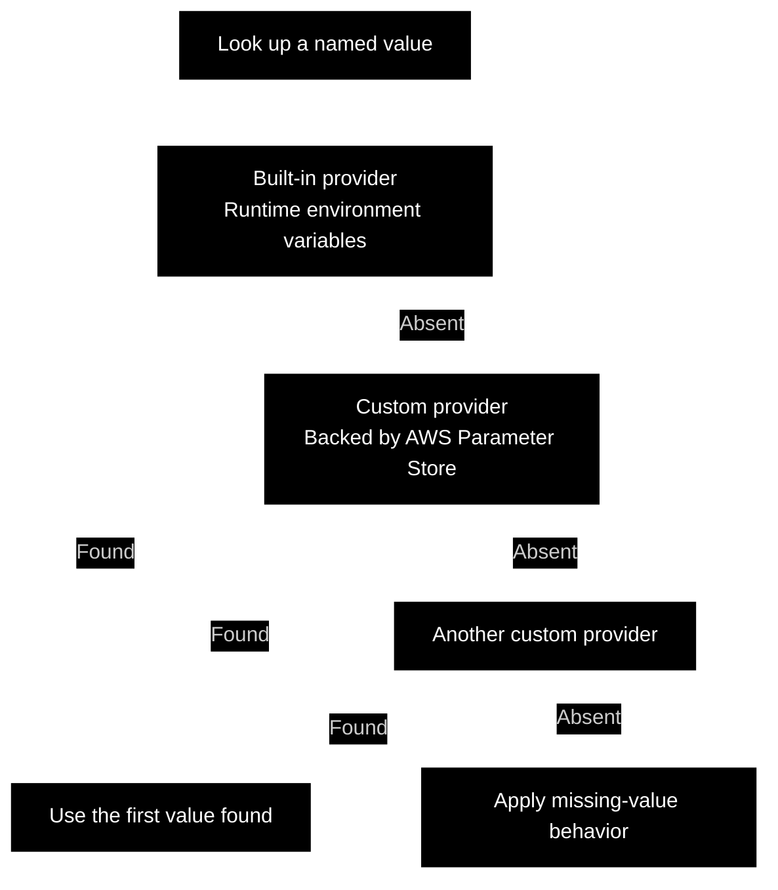
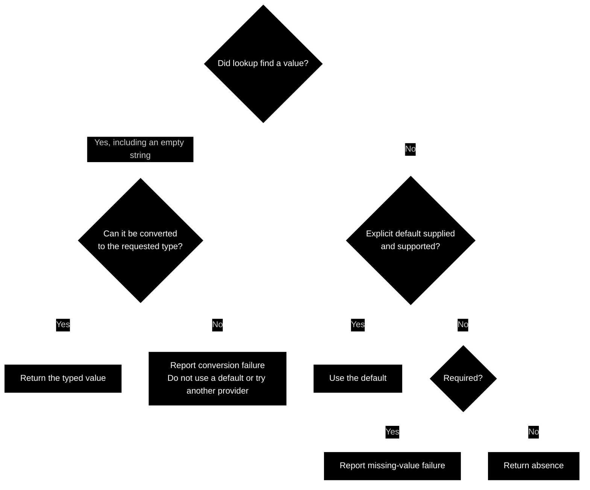

CAE Concept

---

 

### Clean Env Vars

This concept defines how an application retrieves environment variables and converts them into configuration values.

A variable is identified by name and supplied as text. The application declares the type it expects and how absence should be handled.

The environment-variable API can also resolve named configuration values through a configurable chain of providers, allowing configuration to come from the process environment, an external configuration service, or an application-defined source. This describes the intended contract; implementations are not yet available.

 

#### Standalone Use

The environment-variable component can be imported and called directly from application code. It does not require an application framework, a dependency injection container, or a framework-managed configuration lifecycle.

The caller uses its APIs to request a variable by name, specify the expected type, and declare whether the value is required or has a default. The resulting value is available to the calling code for configuration and assembly.

This approach works in a script, a command-line tool, or a framework-based application, with the caller deciding when and where environment variables are read.

 

#### Provider Chain

A **provider** looks up a named value in a particular source. Beyond the built-in environment provider, applications can supply custom providers backed by their chosen clients or application logic. A provider that retrieves values from AWS Systems Manager Parameter Store is one example of a custom provider, rather than a required or built-in integration.

Each programming-language implementation must provide a built-in provider that reads the runtime's actual environment variables. The built-in environment provider is the default source when the caller does not configure a provider chain. The caller can also include that provider in a custom chain at the desired position.

The caller can supply an ordered **provider chain**. For each requested name, the API consults the providers in order and uses the first value found. A provider reporting that the value is absent allows lookup to continue with the next provider.

For example, a chain could check the built-in environment provider first, a custom provider backed by AWS Systems Manager Parameter Store second, and another custom provider last. This allows local overrides while keeping the calling code independent of the source that supplies the value. Applications choose their own providers and precedence.

The diagram shows one possible chain and its found-or-absent outcomes. Provider access failures follow the chain's explicitly defined failure policy.

If every provider reports absence, the API applies the request's missing-value behavior: use an explicit default when supported, or report a failure for a required value.

A found value is converted to the requested type. An empty or invalid value is not an absent value and does not automatically advance lookup to another provider. Likewise, a provider access failure is distinct from absence; the chain must define explicitly whether such a failure stops lookup or permits continuation.

 

#### Retrieval

Retrieval looks up the textual value of a named variable through the configured provider or provider chain.

A **missing value** means the variable is absent. An **empty value** means it exists but contains an empty string. Whether an empty value is acceptable depends on the configuration requirement.

 

#### Conversion

Conversion interprets a retrieved value as the expected type, such as a string, integer, or boolean.

Each type conversion defines the textual forms it accepts. A supplied value outside those forms is invalid. For example, an unrecognized boolean value should produce a conversion failure.

Type conversion establishes the value's representation. Additional constraints, such as a port number's allowed range, belong to configuration validation.

Providers and conversions have separate responsibilities. A provider retrieves text from its configured source; the requested conversion interprets that text as an application value. Selecting an integer type therefore requires parsing the retrieved text, not merely treating the text as if it were already an integer.

 

#### Required Values and Defaults

A required variable must be present. The absence of a required variable produces a mapped configuration failure.

An explicit default, when supported, supplies an acceptable value when the variable is missing. An invalid supplied value still produces a failure; it does not activate the default.

An optional lookup can instead return absence when every provider reports the name missing and no default is supplied. The caller chooses whether absence is acceptable for that configuration requirement. A missing required value, an absent optional value, and an explicitly supplied default represent different outcomes.

 

#### Failure Information

Missing, invalid, and inaccessible variables represent different failure circumstances.

[Mapped exceptions](https://github.com/clean-arch-enablers-project/clean-mapped-exceptions/blob/feature/hello-world/concept/README.md) should identify the variable and the unmet expectation. Conversion or provider-access exceptions should be preserved as original causes when applicable.

Configuration failures are classified according to what the missing, invalid, or inaccessible value means for the calling workflow. Diagnostic information should avoid exposing secret values.

 

#### Application Boundary

Environment access belongs where configuration is obtained and dependencies are assembled.

Application components receive the converted configuration values they need. This makes their configuration requirements explicit and allows them to be exercised without changing the process environment.

The calling code also decides when configuration is resolved. Reading a value during application assembly makes that result available to the assembled components; reading it again is a separate provider lookup. The retrieval API does not automatically update a value already supplied to an application component.

 
 

---

clean software, made easy.

